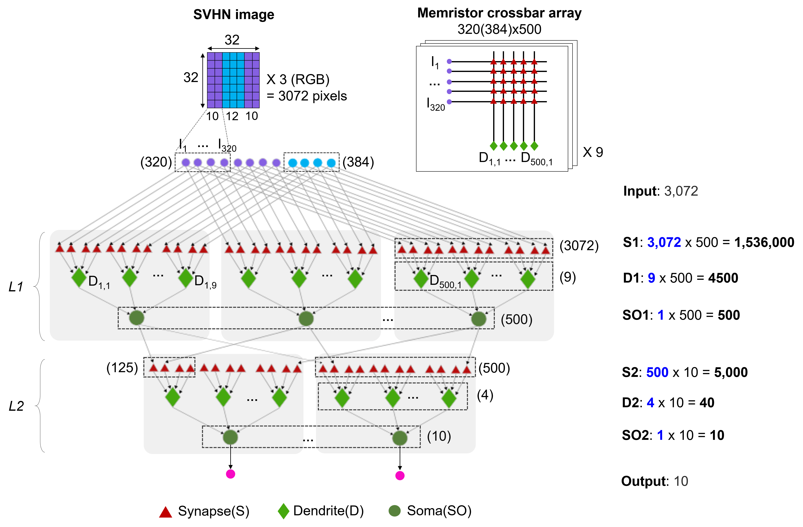

# Hyperbolic embedding of the neuromorphic network

This directory builds the network topology used in the study, computes its
summary measures, embeds the network in hyperbolic space, and produces a
sampled visualization. Synapses and dendritic compartments are represented as
nodes. Connections are treated as binary, undirected edges.



## Workflow

The reproducible workflow has four stages:

1. `build_npc_topology_adjacency.m` constructs the sparse adjacency matrix and
   node-index metadata. It writes both the complete network and the analysis
   network with the nine input nodes removed.
2. `memristor_topological_measures.m` computes the node count, edge count,
   density, mean degree, clustering coefficient, and degree- and
   betweenness-based power-law exponents.
3. `compute_coords_memristor_noleaves.m` removes degree-one nodes, computes a
   two-dimensional coalescent embedding of the remaining core, restores the
   leaves, and writes coordinate and plotting-data files for the two radial
   ranking methods (`exact` and `power`).
4. `panel.m` samples the embedded network by node type, ensures that sampled
   nodes are not isolated, applies the layer/group styling, and exports the
   radial-size panel.

The principal data flow is:

```text
build_npc_topology_adjacency
  -> npc_topology_adjacency-noin.mat
     -> memristor_topological_measures
     -> compute_coords_memristor_noleaves
        -> *_coords.csv and *_plot_data.mat
           -> panel
              -> *_radial_size.png
```

## Requirements

- MATLAB R2020a or later.
- Parallel Computing Toolbox is optional; the supplied topological-measure
  entry point requests serial execution.
- [MatlabBGL](https://github.com/dgleich/matlab-bgl) is required for the
  edge-betweenness pre-weighting used by the supplied embedding configuration.
  Its folder must be on the MATLAB path and a platform-compatible
  `betweenness_centrality_mex` binary must be available. The included
  `betweenness_centrality.m`, `check_matlab_bgl.m`, and C source preserve the
  interface used by this analysis; building the C source also requires the
  headers and libraries distributed with MatlabBGL.

The code uses MATLAB's built-in graph, table, sparse-matrix, plotting, and file
I/O functions. No input dataset needs to be downloaded: the adjacency matrices
are generated by the first stage.

## Setup

1. Clone or download the repository.
2. Install MatlabBGL for the operating system and MATLAB release in use.
3. Start MATLAB and change to this directory.
4. Add this directory and the MatlabBGL installation to the MATLAB path.

For example:

```matlab
cd('/path/to/Network-Neuromorphic-AI/embedding')
addpath(pwd)
addpath(genpath('/path/to/matlab-bgl'))
```

Confirm that the compiled dependency is visible before starting the embedding:

```matlab
which betweenness_centrality_mex
```

## Run the analysis

Run these commands from the `embedding` directory, in order:

```matlab
build_npc_topology_adjacency
memristor_topological_measures
compute_coords_memristor_noleaves
panel
```

The embedding is the expensive stage. If it is interrupted after writing its
intermediate `.mat` file, rerunning the function reuses that file.

## Configuration

The topology dimensions are declared at the beginning of
`build_npc_topology_adjacency.m`. The supplied network contains 9 input nodes,
500 first-layer neurons with 9 dendritic compartments each, and 10 second-layer
neurons with 4 dendritic compartments each.

The embedding settings are declared near the beginning of
`compute_coords_memristor_noleaves.m`. The journal configuration uses EBC
pre-weighting, non-centered Isomap (`ncISO`), equidistant angular adjustment
(`EA`), leaf removal/restoration, and both radial ranking methods. Change these
values only when intentionally running a different analysis.

Generated data, tables, and figures are excluded by `.gitignore`; the source
files and topology schematic remain under version control.

## Method attribution

The coalescent-embedding implementation follows Muscoloni et al., *Nature
Communications* 8, 1615 (2017), DOI: 10.1038/s41467-017-01825-5. Topological
measure and power-law routines retain their original attribution and license
notices in the corresponding source files. Cite those sources, as applicable,
when reporting derived results.
